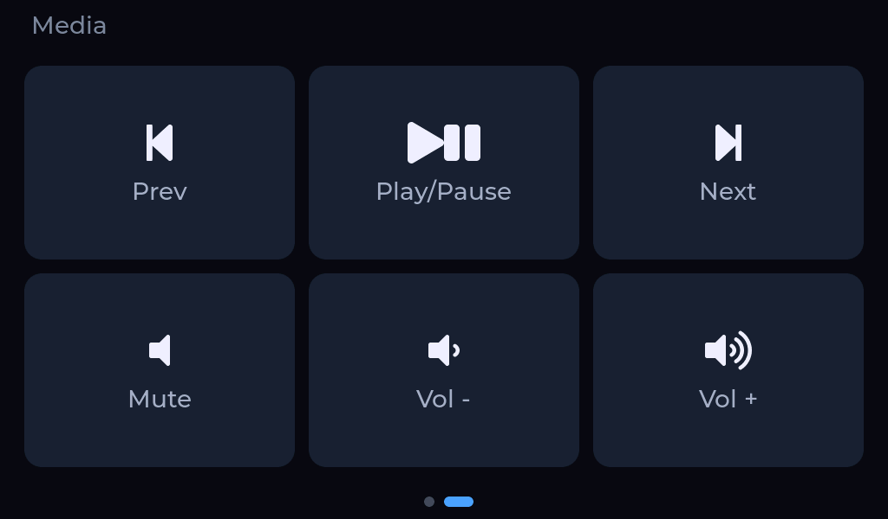
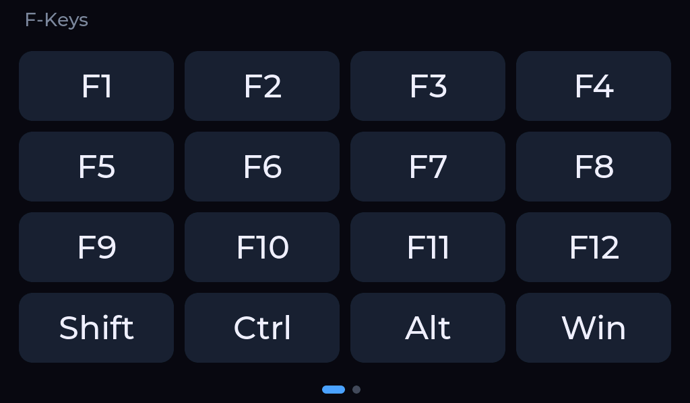

# Open TouchDeck

A customizable touchscreen deck for your desk, built on a 5-inch ESP32-S3 display, with a desktop app to design it.

  
  

[**Download for Windows**](https://github.com/Duresa7/ESP32-TouchDeck/releases/latest/download/OpenTouchDeck-windows-x64-setup.exe) · [**User guide**](docs/usage.md) · [**Releases**](https://github.com/Duresa7/ESP32-TouchDeck/releases)

I made this project to get around the limitations of numpads and other
keyboards that lock useful features behind proprietary software or prevent
full customization. I want a flexible, hardware-controlled interface that I
can customize to fit the way I work.

## Features

- Design pages in the app and push them to your deck over USB, in landscape
  or portrait.
- Use tiles for keys and shortcuts, media keys, launching apps, opening files
  and URLs, and running commands you approve.
- Choose built-in icons or use icons from your own apps.
- Connect your own [CLIProxyAPI hub](https://github.com/router-for-me/CLIProxyAPI)
  to show Codex and Claude 5-hour and 7-day usage limits as widgets and a dashboard page.
- Update your deck's firmware from the app, with automatic rollback if an
  update fails.
- Keep the desktop app up to date with its built-in updater and signed
  installers.

## What you need

- A Waveshare ESP32-S3-Touch-LCD-5B: 16 MB flash, 8 MB PSRAM, 1024×600 touch display.
- A USB data cable.
- A Windows x64 PC. Linux works from a source build.

## Get started

1. Download the [installer from the latest release](https://github.com/Duresa7/ESP32-TouchDeck/releases/latest/download/OpenTouchDeck-windows-x64-setup.exe) and run it. It installs for your user and needs no admin rights.
   Windows SmartScreen may warn the first time, because the installer has no Authenticode signature; choose **More info**, then **Run anyway**.
2. Connect your deck with a USB data cable.
3. Open **Update** in the app. Under **Firmware bundle**, select `%LOCALAPPDATA%\Programs\Open TouchDeck\resources\firmware\touchdeck.tdfw`, which the installer put there, and set **Deck port** to your deck's port, such as `COM3`.
   For a new board or one not running Open TouchDeck, select **Recover deck**. For later updates, select **Update deck**. Keep USB connected until it finishes.
4. In **Deck**, select **Refresh**, then **Connect** beside your deck's port.
5. Design your pages in **Editor** and select **Push**.

Read the [user guide](docs/usage.md) for actions, icons, usage limits, backups, and updates.

## Good to know

- Keep the app running and connected over USB for your deck to type on your PC.
  It is not a standalone USB keyboard yet.
- Hold one finger on the screen for 10 seconds to restart into the built-in layout.
  Your saved files are kept. See [recovery details](docs/firmware.md#recovery).
- Wi-Fi and battery support are planned. Bluetooth is not supported.
- The packaged app is Windows only; Linux runs from source.

## Build from source

- [Desktop app](app/README.md)
- [Firmware](docs/firmware.md)
- [Layout format](schema/README.md)
- [Setup prerequisites](docs/setup.md)
- [Packaging](docs/packaging.md)

## License

Open TouchDeck is licensed under the [Apache License 2.0](LICENSE).

## Icon sources

The icon catalog includes [Simple Icons](https://simpleicons.org) (CC0 1.0, with individual licenses carried in the index) and [selfh.st/icons](https://selfh.st/icons) by selfh.st ([CC BY 4.0](https://creativecommons.org/licenses/by/4.0/)). Icons are resized, padded or tinted to fit your Tile. Logos are trademarks of their owners. Open TouchDeck is not affiliated with or endorsed by them.
