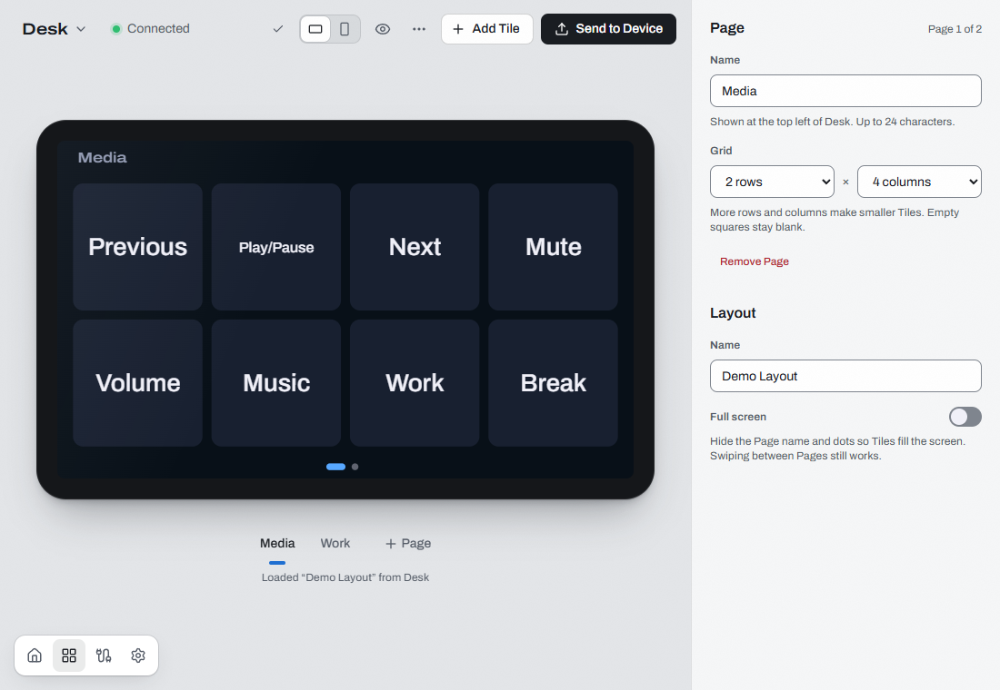
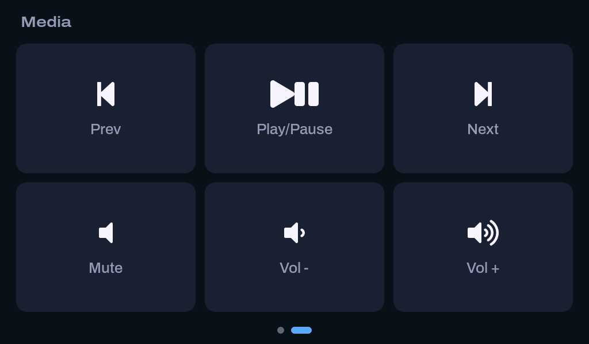
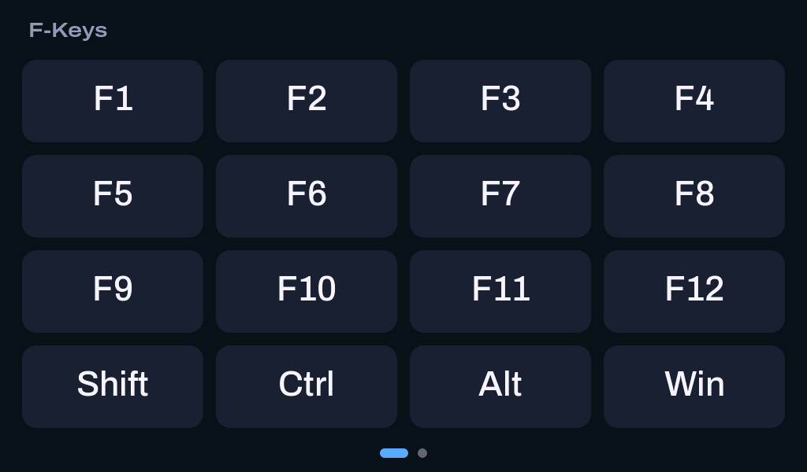

# Open TouchDeck

A customizable touchscreen Device for your desk. Design its Layout in the app, then use its Tiles for shortcuts, live readings and controls on this PC.

[**Download for Windows**](https://github.com/Duresa7/OpenTouchDeck/releases/latest/download/OpenTouchDeck-windows-x64-setup.exe) · [**User guide**](docs/usage.md) · [**Releases**](https://github.com/Duresa7/OpenTouchDeck/releases)

I made this project to get around the limitations of numpads and keyboards that lock useful features behind proprietary software. Layouts, actions and Assets stay customizable.

## Features

- Edit Pages and Tiles in landscape or portrait. Preview a Layout, import or export it and send it over USB.
- Assign shortcuts, modifiers, app launches, file and website opens or commands approved on this PC.
- Add Preset tiles from This PC, CLIProxyAPI, Custom, Volume and Media Integrations.
- Show CPU, memory and network readings, AI usage limits from your own CLIProxyAPI hub or values from HTTP and approved commands.
- Use Graph and other Live tiles, a draggable Volume bar and now-playing controls.
- Choose icons, import animated GIF Tiles or show pictures from a folder when the Device is idle.
- Open the same editor in a paired browser on this PC while the Companion runs in the tray.
- Install Firmware on a New board and update the app and Firmware separately. Firmware updates can roll back after a failed start.

## Get started

You need a **Waveshare ESP32-S3-Touch-LCD-5B** (16 MB flash, 8 MB PSRAM, 1024 × 600 display), a USB data cable and a Windows x64 PC.

1. Download and run the Windows installer. It installs for the current user without administrator rights.
2. Open Open TouchDeck and connect the Device through USB-Serial/JTAG. It connects automatically.
3. For a New board, choose **Install Firmware** and confirm on this PC. This replaces the board's existing project.
4. Follow setup to name the Device, choose its orientation and pick a starting Layout.
5. Open the Device's Layout, edit its Tiles and choose **Send to Device**. If **Controls need Send to Device** appears, choose **Review Layout** and check its Controls list before sending.

The [user guide](docs/usage.md) covers every step, Integrations, pairing, updates and troubleshooting. If upgrading from 0.2, read [the upgrade steps](docs/usage.md#upgrading-from-02), including the required first Layout send for Volume and Media controls.

Keep the Companion running and USB connected for actions on this PC and live readings. Closing the window leaves the Companion in the tray. It reconnects automatically if the Device drops the connection. Turning an Integration off makes its readings on the Device stale within about a second. Swiping Pages and stored animations work on the Device. Wi-Fi, battery support and standalone USB HID are not part of 1.0. Bluetooth is not supported.

## Device screen examples

These captures show the built-in Layout on a real Device. The app screenshots above and in the guide use the current UI with demo data.

  
  

## Build from source

The packaged app is Windows x64. Linux source builds need a desktop session and Device permissions; see [setup](docs/setup.md).

- [App development](app/README.md)
- [Firmware](docs/firmware.md)
- [Layout format](schema/README.md)
- [Packaging and releases](docs/packaging.md)

## License

Open TouchDeck is licensed under the [Apache License 2.0](LICENSE).

## Icon sources

The icon picker searches [Simple Icons](https://simpleicons.org) and [selfh.st/icons](https://selfh.st/icons) by selfh.st. Simple Icons uses CC0 1.0 for most icons; individual licenses and attribution links are carried in the [bundled catalog](app/crates/td-host/src/catalog/index.json). selfh.st icons use [CC BY 4.0](https://creativecommons.org/licenses/by/4.0/). Icons are resized, padded or tinted to fit a Tile, so they are modified from the originals. Logos are trademarks of their owners. Open TouchDeck is not affiliated with or endorsed by them.

Icon packs add more icons on request. **Settings > Icon packs** downloads curated [Iconify](https://iconify.design) sets from the npm registry: SVG Logos (CC0), Devicon (MIT), Skill Icons (MIT), Font Awesome 6 Brands (CC BY 4.0), Material Design Icons (Apache 2.0), Tabler Icons (MIT) and Lucide (ISC). Each download is pinned by version and checksum, and nothing is installed by default. You can also import your own Iconify JSON file or upload an SVG. The picker then searches every installed pack offline, and credits the packs whose license asks for it.

The app also uses [Lucide](https://lucide.dev/license) interface icons and the [Archivo](https://github.com/Omnibus-Type/Archivo) font. See [fonts and licenses](docs/design.md#fonts-and-licenses) and the [icon-source research](docs/research/icon-sources.md).
