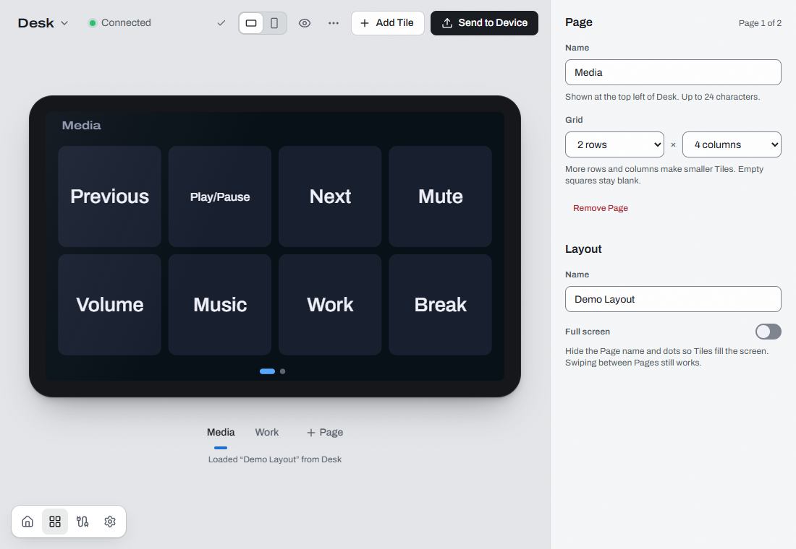
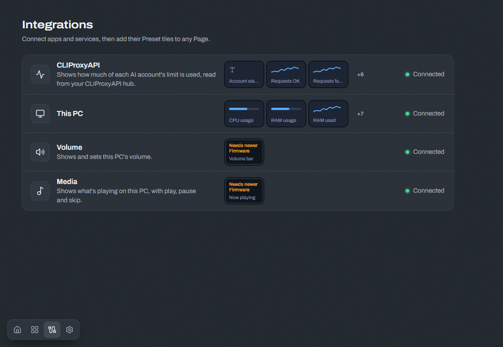

# Open TouchDeck user guide

Design a Layout in the app, send it to a Device and tap its Tiles to use it. A Layout holds Pages; each Page holds Tiles. An Integration supplies live data or controls on this PC. The Companion runs in the tray and connects everything over USB.

This guide covers the 1.0 app. App screenshots use demo data at the default 1100 × 760 window size.

## Install

You need a Waveshare ESP32-S3-Touch-LCD-5B, a USB data cable and Windows x64.

1. Download [OpenTouchDeck-windows-x64-setup.exe](https://github.com/Duresa7/ESP32-TouchDeck/releases/latest/download/OpenTouchDeck-windows-x64-setup.exe) from the project's [releases](https://github.com/Duresa7/ESP32-TouchDeck/releases/latest).
2. Run the installer. It installs for the current user, without administrator rights. No development tools are needed.
3. Open **Open TouchDeck** from the Start menu.

Windows SmartScreen may warn because the installer has no Authenticode signature. Check that the download came from the project's release before choosing **More info > Run anyway**. The built-in updater checks a separate project signature.

The [packaging guide](packaging.md) lists installed files and uninstall behavior. Developers and Linux users should follow [setup](setup.md) and [app development](../app/README.md).

## First run and connection

1. Plug the Device's USB-Serial/JTAG port into this PC with a data cable. Close any serial monitor or flash tool using it.
2. Wait for its Home card to say **Connected**. There is no manual Connect step.
3. If setup opens, enter a name such as “Desk”. The name stays on the Device.
4. Choose **Landscape** or **Portrait**. Each orientation has its own Layout. A change may restart the Device.
5. Choose **Starter Layout**, **Blank Layout** or **Keep** the existing Layout when offered.
6. If a Firmware update is offered, choose **Update** and keep USB connected, or **Skip** to continue with the current Firmware.
7. Choose **Edit Layout** to customize it, or **Done** to return Home.

Click the Device on Home to edit it. The bottom-left navigation opens Home, Layout, Integrations and Settings. In Settings, choose **Appearance** and whether to **Start at sign-in**.

Closing the window leaves the Companion running in the tray. **Open** brings the window back; **Quit** stops it. Keep the Companion running for keyboard input, commands, Volume, Media and live readings. Keyboard Tiles send input to the focused window on this PC. The Device is not a standalone USB keyboard.

## Install Firmware on a New board

A supported board without working Open TouchDeck Firmware appears as **New board**.

1. Choose **Install Firmware** on its card.
2. Read the warning. Installation replaces everything on the board, including another project. Cancel if you need to preserve it.
3. Confirm the target and bundle in the native confirmation dialog on this PC. A browser cannot give this approval.
4. Keep USB connected while **Installing Firmware…** is shown.
5. After **Firmware installed**, choose **Next** and follow the naming and Layout steps above.

**Ignore** leaves the board unchanged. Select its ignored card later to install. If installation fails, read **Details**, unplug and reconnect the board, then retry. The installer includes the Firmware bundle; no separate Python or flashing tool is needed for this flow.

## Edit a Layout



1. Open a Device from Home. At **Start a Layout**, choose **Load from Desk** (using the Device's name), **Starter Layout**, **Blank Layout** or **Import**.
2. Select a Page below the preview. **+ Page** adds another Page.
3. Select a Tile to edit its label, icon, color, size and action in the right panel. **Add Tile** or an empty cell opens the choices for action Tiles and Preset tiles.
4. Drag Tiles to move them. Use the size controls to resize them. Changes that overlap another Tile or go outside the grid are refused.
5. Click away from a Tile to edit the Page name and grid. **Full screen** hides the Page name and dots; swiping still changes Pages.
6. Choose **Send to Device**. Wait for confirmation that the Layout was sent before unplugging.

The orientation buttons in the editor choose which Layout to edit. They do not turn the Device. To change how it stands, click its name, change **Orientation** in the Device panel and confirm **Restart**. Send the other orientation's Layout separately.

Choose **Preview** or press **P** to try Page swipes, Tile presses and Page jumps. Arrow keys change Pages. **Actual size** shows Device pixels at their original size. Preview does not run commands on this PC.

### Actions and approvals

Under **When tapped**, choose a key or shortcut, media key, modifier, app launch, file or website open, command, Page jump or no action. **When held** gives an action a separate hold behavior where offered.

For a command, enter the program, arguments and working folder in the action form. Check each argument. Shell mode does not turn the program field into a general shell script.

The first attempt to start an unapproved program opens a native dialog on this PC. This applies to commands, app launches and file or folder opens; ordinary HTTP, HTTPS and mail links do not need process approval. Review the exact program, arguments, working folder and shell setting, then choose **Run once**, **Always allow** or **Deny**.

**Always allow** remembers that exact command on this PC. Changing its arguments or other approved fields asks again. A Layout imported from someone else cannot approve itself. If the app says **Waiting for approval on this PC**, find the native dialog or use **Show prompt again**. Device key input pauses while a native approval dialog is open.

### Icons, Assets and backups

Use the Tile's **Icon** controls to choose a built-in symbol, search the catalog or use an app's icon where offered. Search uses the bundled catalog; picking an uncached catalog image needs internet access. The Companion prepares it as an Asset for the Device.

Drafts are kept in this window or browser's local storage, separately for each Device and orientation. Export files for backups and transfers between browsers or PCs.

The **Layout options** menu (three dots) offers **Export**, **Import**, **Load from Desk**, starting Layouts and **Remove unused Assets**. Export both orientations before replacing a Layout. Open the exported files again to check them.

A Layout JSON file contains Asset references, not the image files, Integration secrets or command approvals. Keep original custom images and GIFs separately. On another PC, set up Integrations again, check program paths and prepare missing Assets before sending. Loading a Layout from the Device does not copy its Assets back to this PC. Remove unused Assets only after keeping the originals you need.

## Set up Integrations



Open **Integrations**, select one and turn it on. Choose **Save** for configuration changes. Secrets have their own **Save** and **Forget** controls. Use **Check now** when available, then inspect **Details** if it cannot connect.

Choose a Preset tile's **Add to Layout**, select its destination when asked, then open Layout and **Send to Device**. Adding a Preset tile edits the Layout; it does not send it automatically.

### This PC

Turn on **This PC** and save. It needs no account or key. Add its CPU, memory or network Preset tiles. For a Graph Tile, select the value, display style, history and accent in the inspector. A graph needs enough room; unavailable sizes are disabled.

### CLIProxyAPI usage limits

Use your own CLIProxyAPI hub and its management key. Open TouchDeck does not sign in to AI providers for you.

1. Set up the hub and sign the desired accounts into it. Enable its management API.
2. In **Integrations > CLIProxyAPI**, turn it on. Replace the placeholder `https://YOUR_HUB_URL` with your hub's address.
3. Set **Check every** and choose **Save**. The default is 120 seconds; polling cannot be faster than 60 seconds.
4. Paste your own `YOUR_MANAGEMENT_KEY` into **Management key** and use its **Save** button. Do not put the key in a Layout or share it in a screenshot.
5. Choose **Check now**. Check the account table before adding a Preset tile.
6. Add a usage Tile, select its account and value, then **Send to Device**.

Use HTTPS for a remote hub. Plain HTTP on a private network exposes the key in transit; public HTTP is refused. Keys are stored in the OS credential store, which is Windows Credential Manager on Windows.

Codex and Claude readings include 5-hour and 7-day usage limits and resets when available. Other providers can supply account status and request counts. An unavailable limit is not zero. **All accounts** uses the highest usage percentage for each window. Check-now requests share a cooldown. After repeated failed checks, readings become stale and Tiles grey out.

Use **Forget** beside the key to remove it. Uninstalling the app does not remove Integration secrets from Windows Credential Manager.

### Custom HTTP values

**Custom** reads numbers or text from an HTTP response or an approved command. Its **Custom sources (JSON)** field holds a list, with at most 16 entries. Each entry needs a unique `id`, a `name`, `interval_s` (1 to 3600), a `kind` (`number` or `text`) and an `input`.

For an HTTP response such as `{"temperature": 21.5}`, adapt this example. Replace the address before saving:

```json
[
  {
    "id": "temperature",
    "name": "Temperature",
    "interval_s": 30,
    "kind": "number",
    "input": {
      "type": "http",
      "url": "https://YOUR_SERVICE_URL/metrics",
      "value_path": "$.temperature",
      "headers": {}
    }
  }
]
```

Turn on Custom and choose **Save**, then **Check now**. Paths start at `$`; use `.field` for an object field or `[0]` for an array element. Wildcards are not supported. The selected value must match `kind`.

For authentication, map an HTTP header to a secret-field name, for example `"headers": {"Authorization": "metrics_token"}`. Save the configuration, then enter the complete header value in the generated secret field and save it separately. Keep secret values out of the JSON. Changing the service address may require saving its secret again.

Numeric entries offer value and graph Preset tiles. Add one and send the Layout.

### Custom command values

For a command, use the same outer entry and replace `input` with:

```json
{
  "type": "command",
  "program": "C:/Tools/YOUR_PROGRAM.exe",
  "args": ["--print-value"],
  "value_path": null
}
```

Replace the program and arguments with a program you trust. Use an absolute executable path; Windows commands must use an `.exe` or `.com` program. With `value_path: null`, the program's output is read as the selected number or text. If it prints JSON, use a path such as `$.value` instead.

Save and check the Integration. Approve the command in the native dialog on this PC. **Run once** allows one execution; a polling command needs **Always allow** to keep running without new approvals. **Deny** leaves it unable to run. Editing the command asks again. Command output must be small and finish promptly; failures appear in the Integration's status.

### Volume

Turn on **Volume**, save and add **Volume bar**. Send the Layout, then drag along the bar on the Device to change this PC's default output volume. Its live level follows changes made on this PC too. It needs an available audio output and current Firmware.

### Media

Turn on **Media**, save and add **Now playing**. Start playback in an app that exposes a Windows media session, then send the Layout. The Tile shows title, artist, cover art and playback state when the player supplies them. Its control parts are previous, play/pause and next. Tap the relevant control on the Device. A player may not support every control or supply cover art. The Tile is not a seek slider.

## Animated GIF Tiles

Choose **Add Tile > GIF**, select a file and choose **Whole GIF** or **Fill Tile**. Wait for preparation to finish, inspect the fitted dimensions and timing, then **Send to Device**. **Change GIF** replaces it later.

The Companion resizes and resamples the animation for the Device; the Firmware plays it from stored Assets. Current Firmware allows up to 128 × 128 pixels per GIF, 60 frames, at least 100 ms per frame (10 frames per second), and four animated Tiles per Page. The per-Page pixel budget is 65,536; total decoded frame pixels per GIF are capped at 983,040. Prepared Assets must also fit the 262,144-byte Asset limit. The app checks the connected Device's reported limits, so older Firmware may offer less or require an update.

If preparation fails, shorten the animation, reduce its dimensions or use fewer animated Tiles. Resizing a Tile can require preparing its GIF again. Keep the original GIF for later edits and backups.

## Photo frame and idle screen

Click the Device's name to open its panel. Turn on **Photo frame**, set **Start after** and use **Choose folder** in the desktop app. Pick a folder of pictures on this PC. Folder selection is not available in the browser.

When idle, the Device shows pictures sent by the Companion, one at a time. They are not kept on the Device. Without the Companion, the idle screen shows a clock. Touch the screen to return to the Layout. Change **Brightness** in the same panel. If a field says it needs newer Firmware, update before using it.

## Use the browser version

Keep the Companion running on this PC. Choose **Open in browser** from the tray menu. The default browser opens and pairs automatically. If it asks for a code, enter the code shown on this PC within two minutes. For another browser, use the same address and a fresh pairing code.

Pairing survives refreshes. After the Companion restarts, choose **Open in browser** again. **Settings > Paired browsers > Forget** signs that browser out, including its other tabs. Other paired browsers stay connected.

Browser access is local to this PC, not available to a phone or another PC on the network. Command and Firmware approvals still happen in a native dialog on this PC. Choose photo folders and install app updates from the desktop app.

## Updates and Firmware rollback

### Update the app

1. Export any Layout drafts you want to keep.
2. Open **Settings > About > Check for updates**, or the **Update available** icon beside navigation.
3. Review the release notes and choose **Update**. You can keep working during the download.
4. At **Ready to restart**, choose **Restart**. Wait for any Device transfer to finish first.

The app verifies the update signature before running the installer. If verification fails, leave the current version installed and retry later. The update keeps user data and restarts Open TouchDeck. It does not update Device Firmware.

### Update Firmware

Click the Device's name in Layout. If newer Firmware is offered, choose **Update** in its panel. Keep USB connected through the restart and wait for the success message.

To use a release's `.tdfw` bundle, open **Settings > Troubleshooting > Update from a file** and choose the file for the intended Device. Use a bundle for the supported board, not the desktop installer. A downgrade requires confirmation in the native dialog on this PC.

Normal updates write the inactive Firmware slot. If the new Firmware fails to confirm a successful start, the Device can roll back to the previous slot. Read the result after the restart: reaching 100% transfer does not prove the new Firmware started. If the app reports rollback, the previous Firmware still runs; check **Details** before retrying.

### Upgrading from 0.2

Install the new app by hand from the release. There is no automatic bridge from 0.2, and its app Layout drafts and settings do not carry over. Export old Layouts and keep original Assets before replacing the old app. Load the Device's Layout or import an exported file, then set up Integrations again.

**After updating, Volume and Media control Tiles respond only after you send their Layout from the app once. Choose Send to Device.** The Companion acts only on a Layout it pushed itself. Merely loading the Device's Layout does not authorize its controls. Repeat for each Device and orientation you use.

App launches and file opens can now ask for command approval on this PC too.

## Troubleshooting

| What you see | What to do |
| --- | --- |
| No Device on Home | Use a USB data cable and the USB-Serial/JTAG port. Unplug and reconnect. Linux source builds also need serial permissions from the [setup guide](setup.md). |
| In use by another program | Close serial monitors and flash tools. The Companion reconnects automatically. |
| Not connected | Check USB, then open **Settings > Troubleshooting** for connection details and the last error. |
| Couldn't send a Layout | Read **Details**, reconnect and retry. Check that its Tiles and Assets fit the Device's capabilities. |
| Needs newer Firmware | Update from the Device panel. Older Firmware cannot draw every Live tile or animation. |
| Volume or Media does not respond after an upgrade | Enable the Integration and choose **Send to Device** once. For Media, start a supported player; for Volume, check the default audio output. |
| Waiting for approval on this PC | Find the native dialog. Check the exact command before approving. |
| A Live tile is blank or grey | Keep the Companion running. Check the Integration's status, credentials and **Details**, then retry its check. |
| Photo folder is missing | Choose an existing folder again in the desktop app. |
| Pairing code is wrong or expired | Choose **Open in browser** from the tray again for a new code. |
| Firmware update failed | Keep the Device plugged in until the result is known. Check whether it rolled back, then read **Details** before retrying. |

**Settings > Troubleshooting** includes Device details and a Firmware console. Logs can contain personal data; remove it before sharing. If the Device's Layout prevents normal use, its ten-second touch hold starts the built-in Layout without removing stored files. See [Firmware recovery](firmware.md#recovery) before using it.
